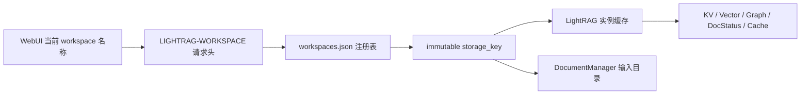

# Workspace 业务逻辑变更说明

本文档整理本次对 LightRAG workspace 管理能力的业务逻辑修改，覆盖后端资源模型、API、前端状态与 UI、运行时部署、测试验证，以及对话过程中发现并修复的问题。

## 1. 修改目标

本次修改的目标是把项目从“单 workspace 隐式运行”升级为“可在 WebUI 中管理多个 workspace”。

核心能力包括：

- workspace 列表展示
- 创建 workspace
- 切换 workspace
- 重命名 workspace
- 删除 workspace
- 所有文档、查询、图谱、健康检查请求按当前 workspace 隔离访问
- WebUI 顶部 Header 中直接展示 workspace 管理入口

UI 位置按最终要求调整为：

```text
Documents / Knowledge Graph / Retrieval / API / Workspace / Guest Mode
```

也就是 workspace 管理控件位于 `API` Tab 右侧，`Guest Mode` / `login free` 左侧。

## 2. 总体业务模型

本次引入了一个独立的 workspace 注册表模型，把“用户看到的 workspace 名称”和“底层存储隔离键”拆开。



### 2.1 为什么拆成 `name` 和 `storage_key`

业务上用户需要“重命名 workspace”。

如果直接把 workspace 名称作为所有底层存储命名空间，重命名就意味着要迁移：

- 文件目录
- JSON KV 文件
- 向量库 collection / payload
- 图数据库标签或 namespace
- PostgreSQL workspace 字段
- Qdrant / Milvus / Neo4j 等后端中的隔离标识

这类跨存储迁移风险高，且各后端语义不一致。

因此本次设计为：

| 字段 | 作用 | 是否可变 |
|---|---|---|
| `name` | WebUI 展示名、API 请求名、用户选择名 | 可变 |
| `storage_key` | 底层存储隔离键、实例缓存键、文件目录名 | 创建后不可变 |

重命名只修改 `name`，不移动底层数据。

示例注册表结构：

```json
{
  "workspaces": [
    { "name": "default", "storage_key": "default" },
    { "name": "renamed-demo", "storage_key": "demo" }
  ]
}
```

这里 `renamed-demo` 是用户看到的新名字，但实际底层数据仍在 `demo` 对应的存储空间中。

## 3. 后端修改

### 3.1 新增 `lightrag/api/workspace.py`

新增独立模块承载 workspace 管理职责，避免继续扩大 `lightrag_server.py`。

主要职责：

- 加载和保存 workspace 注册表
- 维护 `name -> storage_key` 映射
- 维护每个 `storage_key` 对应的 `LightRAG` 实例缓存
- 维护每个 `storage_key` 对应的 `DocumentManager` 实例缓存
- 提供 request-scoped 当前 workspace 上下文
- 提供 workspace 创建、重命名、删除业务操作
- 提供兼容现有路由闭包风格的 `rag` / `doc_manager` 代理

核心对象：

| 对象 | 作用 |
|---|---|
| `WorkspaceEntry` | 单个 workspace 注册项，包含 `name` 和 `storage_key` |
| `WorkspaceResources` | workspace 注册表、资源缓存和 CRUD 业务入口 |
| `WorkspaceRagProxy` | 兼容旧路由的 `rag` 代理，按当前请求 workspace 解析真实实例 |
| `WorkspaceDocManagerProxy` | 兼容旧路由的 `doc_manager` 代理，按当前请求 workspace 解析真实实例 |

### 3.2 Workspace 注册表加载与兼容

注册表文件位于：

```text
{working_dir}/workspaces.json
```

当前支持两种格式：

1. 新格式：对象列表

```json
{
  "workspaces": [
    { "name": "demo", "storage_key": "demo" }
  ]
}
```

2. 旧格式：字符串列表

```json
["default", "demo"]
```

旧格式会被解释为：

```json
{ "name": "demo", "storage_key": "demo" }
```

如果注册表不存在，系统会自动创建默认 workspace 的内存注册项：

```text
name = args.workspace 或 default
storage_key = args.workspace 或 default
```

### 3.3 Workspace 名称校验

workspace 名称通过已有的 `validate_workspace()` 校验，不再做静默替换。

之前部分逻辑会把非法字符替换为 `_`，本次改为：

- 非法名称直接返回 `400`
- 空名称返回 `400`
- 名称长度超过 64 返回 `400`
- 不允许路径穿越等不安全名称

这样可以避免用户以为创建的是一个名称，实际落到另一个被静默改写的名称。

### 3.4 创建 workspace

创建流程：

```text
POST /workspaces { name }
  -> 校验 name
  -> 检查是否重名
  -> 创建 storage_key
  -> 写入 workspaces.json
  -> 创建 working_dir/storage_key
  -> 创建 input_dir/storage_key
  -> 初始化该 workspace 的 LightRAG
  -> 创建该 workspace 的 DocumentManager
```

业务保护：

- 名称不能为空
- 名称必须安全
- 名称不能重复
- `storage_key` 如果冲突，会自动生成 `workspace_<uuid>` 形式的唯一值

### 3.5 重命名 workspace

重命名流程：

```text
PUT /workspaces/{workspace} { name }
  -> 校验旧名称和新名称
  -> 禁止重命名默认 workspace
  -> 检查旧 workspace 是否存在
  -> 检查新名称是否重复
  -> 只更新注册表中的 name
  -> 保持 storage_key 不变
```

重命名不会：

- 移动输入目录
- 移动 working 目录
- 修改向量库 collection
- 修改图数据库 namespace
- 修改历史数据中的 workspace 字段

因此该操作是轻量且低风险的。

### 3.6 删除 workspace

删除流程：

```text
DELETE /workspaces/{workspace}
  -> 校验 workspace
  -> 禁止删除默认 workspace
  -> 检查 workspace 是否存在
  -> 检查该 storage_key 的 pipeline 是否活跃
  -> drop 各类 storage
  -> finalize storage
  -> 删除 working/input 目录
  -> 移除 RAG / DocumentManager 缓存
  -> 从注册表删除
```

删除前会检查 pipeline 状态：

- `busy`
- `scanning`
- `destructive_busy`
- `pending_enqueues > 0`

只要任一状态活跃，就拒绝删除并返回 `409`。

这是为了避免删除时与上传、扫描、索引、清空、单文档删除等流程并发，导致数据写入正在被销毁的存储。

### 3.7 Request-scoped workspace 上下文

后端通过 `LIGHTRAG-WORKSPACE` 请求头选择当前 workspace。

```http
LIGHTRAG-WORKSPACE: upload_data
```

在 `lightrag_server.py` 中加入 middleware：

```text
请求进入
  -> 判断是否是 workspace 相关路径
  -> 读取 LIGHTRAG-WORKSPACE header
  -> 解析显示名 name
  -> 映射到 storage_key
  -> 初始化对应 LightRAG 资源
  -> 将当前 workspace 写入 contextvar
  -> 路由执行
  -> 请求结束后重置 contextvar
```

当前纳入 workspace 上下文的路径包括：

- `/documents`
- `/query`
- `/graph`
- `/graphs`
- `/api/generate`
- `/api/chat`
- `/health`

### 3.8 保持旧路由结构兼容

现有 `document_routes`、`query_routes`、`graph_routes`、`ollama_api` 主要依赖闭包传入的 `rag` / `doc_manager`。

为了避免大范围重构路由签名，本次使用代理对象兼容旧结构：

```text
旧路由读取 rag.doc_status
  -> WorkspaceRagProxy.__getattr__
  -> 从 contextvar 获取当前 workspace name
  -> resolve storage_key
  -> 返回该 storage_key 对应的真实 LightRAG 实例属性
```

同理，`doc_manager.input_dir` 会解析到当前 workspace 的输入目录。

### 3.9 Startup / Shutdown 行为调整

原逻辑：

```text
启动时初始化单个 rag
关闭时 finalize 单个 rag
```

新逻辑：

```text
启动时初始化默认 workspace 的 rag
运行时按需初始化其他 workspace 的 rag
关闭时 finalize 所有已缓存 workspace 的 rag
```

这样既保留启动时默认 workspace 可用，又避免一次性初始化所有 workspace 带来的启动成本。

### 3.10 `/health` 行为调整

`/health` 现在按当前请求 workspace 返回状态。

返回配置中新增/调整：

- `configuration.workspace`：当前显示 workspace 名称
- `configuration.workspace_storage_key`：实际底层 storage key
- `configuration.default_workspace`：默认 workspace
- pipeline 状态按 `storage_key` 查询

这保证切换 workspace 后，WebUI 健康状态与后端实际工作空间一致。

## 4. 后端 API 变更

新增 API：

| 方法 | 路径 | 作用 |
|---|---|---|
| `GET` | `/workspaces` | 获取 workspace 列表 |
| `POST` | `/workspaces` | 创建 workspace |
| `PUT` | `/workspaces/{workspace}` | 重命名 workspace |
| `PATCH` | `/workspaces/{workspace}` | 兼容重命名接口，隐藏于 OpenAPI |
| `DELETE` | `/workspaces/{workspace}` | 删除 workspace |

### 4.1 `GET /workspaces`

返回示例：

```json
{
  "workspaces": [
    {
      "name": "default",
      "storage_key": "default",
      "is_default": true
    },
    {
      "name": "upload_data",
      "storage_key": "upload_data",
      "is_default": false
    }
  ],
  "current_workspace": "default",
  "default_workspace": "default"
}
```

### 4.2 `POST /workspaces`

请求：

```json
{
  "name": "demo"
}
```

成功后会创建 workspace、初始化资源，并把新 workspace 作为当前响应项返回。

### 4.3 `PUT /workspaces/{workspace}`

请求：

```json
{
  "name": "renamed-demo"
}
```

响应中的 `storage_key` 保持原值。

### 4.4 `DELETE /workspaces/{workspace}`

删除成功后返回新的 workspace 列表、被删除的 workspace 信息，以及被删除的目录列表。

默认 workspace 不允许删除。

## 5. 前端修改

### 5.1 `lightrag_webui/src/api/lightrag.ts`

新增 workspace API 类型和函数：

- `WorkspaceInfo`
- `getWorkspaces()`
- `createWorkspace(name)`
- `renameWorkspace(workspace, name)`
- `deleteWorkspace(workspace)`

同时修改请求层：

- Axios 普通请求自动注入 `LIGHTRAG-WORKSPACE`
- fetch / streaming 请求也注入 `LIGHTRAG-WORKSPACE`

这样文档列表、上传、查询、图谱、流式查询等请求都会跟随当前 workspace。

### 5.2 `lightrag_webui/src/stores/settings.ts`

新增持久化字段：

```text
workspace: string
```

新增行为：

```text
setWorkspace(workspace)
```

当用户实际切换到不同 workspace 时，会清空跨 workspace 的 UI 状态：

- retrieval history
- query label

persist 版本从 `20` 升级到 `21`，迁移时为旧用户补充 `workspace` 字段。

### 5.3 `lightrag_webui/src/stores/workspace.ts`

新增 workspace store，集中管理 workspace 业务状态。

状态包括：

- `workspaces`
- `defaultWorkspace`
- `currentWorkspace`
- `isFetching`
- `lastFetchTime`
- `error`

行为包括：

- `fetchWorkspaces()`
- `selectWorkspace(workspace)`
- `createWorkspace(name)`
- `renameWorkspace(workspace, name)`
- `deleteWorkspace(workspace)`
- `reset()`

关键行为：

- 从后端同步 workspace 列表
- 自动修正当前选中的 workspace
- 创建后自动选中新 workspace
- 重命名后自动选中新名称
- 删除后自动回落到默认 workspace 或可用 workspace
- workspace 变化后触发后端 health refresh

### 5.4 `lightrag_webui/src/features/SiteHeader.tsx`

新增 `WorkspaceManager` 组件。

功能包括：

- workspace 下拉选择
- 创建 workspace 弹窗
- 重命名 workspace 弹窗
- 删除 workspace 确认弹窗
- 默认 workspace 标识
- 默认 workspace 禁止重命名和删除
- 操作失败 toast 提示
- 操作成功后清理图谱和检索相关 UI 状态

最终布局：

```text
<TabsNavigation />
<WorkspaceManager />
Guest Mode / login-free
```

不再放在右侧设置区，避免用户看不到。

### 5.5 i18n 文案

至少更新：

- `lightrag_webui/src/locales/en.json`
- `lightrag_webui/src/locales/zh.json`

新增文案范围：

- `common.create`
- `common.delete`
- `workspace.select`
- `workspace.create`
- `workspace.rename`
- `workspace.delete`
- `workspace.createTitle`
- `workspace.renameTitle`
- `workspace.deleteTitle`
- `workspace.nameRequired`
- `workspace.defaultBadge`
- 以及弹窗描述类文案

## 6. 运行时与 Docker 修改

### 6.1 问题背景

源码和 WebUI build 都已经更新后，用户仍然看不到 Header 中的 workspace UI。

排查发现，`docker-compose.yml` 原本只挂载了数据和 `.env`，没有挂载本地 `./lightrag`：

```text
./data/rag_storage:/app/data/rag_storage
./.env:/app/.env
```

这意味着运行中的容器仍可能使用旧镜像内置的后端代码和静态 WebUI，而不是本地最新修改。

### 6.2 修改内容

`docker-compose.yml` 增加：

```yaml
- ./lightrag:/app/lightrag
```

这样容器可以直接读取本地修改后的：

- `lightrag/api/lightrag_server.py`
- `lightrag/api/workspace.py`
- `lightrag/api/webui`

同时当前 compose 中服务运行在：

```text
http://localhost:9622
```

### 6.3 重启结果

执行过：

```bash
docker compose up -d --build --force-recreate
```

该命令在 build 阶段失败，原因是 Dockerfile 使用：

```bash
bun install --frozen-lockfile
```

但容器内 Bun 判断 `lightrag_webui` lockfile 需要更新。

随后执行不 build 的强制重建：

```bash
docker compose up -d --force-recreate
```

结果：容器 `lightrag-upload` 已启动，端口映射为：

```text
0.0.0.0:9622 -> 9622/tcp
```

因为已经挂载本地 `./lightrag`，不重新 build 镜像也能让后端源码和静态 WebUI 目录生效。

## 7. 对话中发现并修复的问题

### 7.1 `/documents/paginated` 500 错误

用户反馈：

```text
Failed to load documents 500 Internal Server Error
{"detail":"'NoneType' object does not support the asynchronous context manager protocol"}
/documents/paginated
```

根因：

- `WorkspaceRagProxy` 在应用装配阶段可能被同步访问
- 同步访问会提前创建并缓存一个未初始化的 `LightRAG` 实例
- 后续异步路径 `get_rag_by_name()` 看到缓存中已有实例，直接返回
- 导致该实例没有执行 `initialize_storages()`
- `rag.doc_status._storage_lock` 仍是 `None`
- `/documents/paginated` 内部执行 `async with self._storage_lock` 时触发 500

修复：

- 修改 `WorkspaceResources.get_rag_by_name()`
- 即使缓存中已有 `rag`，也必须检查该 `storage_key` 是否已初始化
- 未初始化时补跑：

```text
await rag.initialize_storages()
await rag.check_and_migrate_data()
```

并把 `storage_key` 标记到 `_initialized_storage_keys`。

新增回归测试覆盖：

```text
同步代理先创建 RAG -> 异步 get_rag_by_name 仍必须初始化该 RAG
```

## 8. 当前用户数据所在 workspace

通过本地持久化目录确认，之前上传/导入的文本数据位于：

```text
upload_data
```

证据：

```text
D:\Code\lightrag_Origin\LightRAG\data\rag_storage\upload_data
D:\Code\lightrag_Origin\LightRAG\data\inputs\upload_data
```

因此 WebUI 里应选择：

```text
upload_data
```

API 调用时应携带：

```http
LIGHTRAG-WORKSPACE: upload_data
```

## 9. 测试与验证

### 9.1 后端验证

已运行：

```bash
python -m py_compile "lightrag/api/workspace.py" "lightrag/api/lightrag_server.py"
python -m py_compile "lightrag/api/workspace.py" "lightrag/api/lightrag_server.py" "tests/api/routes/test_workspace_routes.py"
python -m pytest "tests/api/routes/test_workspace_routes.py"
```

`tests/api/routes/test_workspace_routes.py` 覆盖：

- workspace 列表
- 创建 workspace
- 重命名 workspace 且保持 `storage_key` 不变
- 删除 workspace 并清理目录
- 默认 workspace 不可删除
- 默认 workspace 不可重命名
- 重名冲突
- 非法名称拒绝
- 同步代理提前创建 RAG 后仍能异步初始化

### 9.2 前端验证

已运行：

```bash
bun test "src/api/lightrag-workspace.test.ts"
bunx eslint --max-warnings=0 "src/api/lightrag-workspace.test.ts"
bunx eslint --max-warnings=0 "src/features/SiteHeader.tsx"
bunx eslint --max-warnings=0 "src/features/SiteHeader.tsx" "src/stores/workspace.ts" "src/stores/settings.ts" "src/api/lightrag.ts" "src/api/lightrag-workspace.test.ts"
bun run build
```

前端测试覆盖：

- workspace API 请求
- Axios header 注入
- fetch / stream 请求携带 `LIGHTRAG-WORKSPACE`

### 9.3 Docker Compose 验证

已运行：

```bash
docker compose config --quiet
```

已成功执行：

```bash
docker compose up -d --force-recreate
```

## 10. 修改文件清单

本次 workspace 业务相关文件：

### 后端

- `lightrag/api/workspace.py`
- `lightrag/api/lightrag_server.py`
- `tests/api/routes/test_workspace_routes.py`

### 前端

- `lightrag_webui/src/api/lightrag.ts`
- `lightrag_webui/src/api/lightrag-workspace.test.ts`
- `lightrag_webui/src/stores/settings.ts`
- `lightrag_webui/src/stores/workspace.ts`
- `lightrag_webui/src/features/SiteHeader.tsx`
- `lightrag_webui/src/locales/en.json`
- `lightrag_webui/src/locales/zh.json`

### 运行时

- `docker-compose.yml`

## 11. 业务边界和限制

当前设计有意保留以下边界：

1. 重命名不迁移底层数据

   这是核心设计，不是遗漏。`storage_key` 不变可以避免跨存储后端迁移风险。

2. 默认 workspace 不允许删除或重命名

   默认 workspace 是系统兜底入口，删除或重命名会导致无可用回退目标。

3. 删除 workspace 是破坏性操作

   删除会 drop 当前 workspace 的存储，并删除对应输入目录和 working 目录。

4. 删除时不允许 pipeline 活跃

   防止上传、扫描、索引、删除、清空等流程并发破坏数据一致性。

5. 未注册 workspace 不允许通过 header 临时访问

   `LIGHTRAG-WORKSPACE` 必须对应注册表中存在的 `name`。

6. 旧数据所在 workspace 需要用户切换

   当前用户历史文本在 `upload_data`，WebUI 初始如果停留在 `default`，文档列表会为空，需要切换到 `upload_data`。

## 12. 最终使用方式

### WebUI

1. 打开：

```text
http://localhost:9622
```

2. 在顶部 Header 的 `API` 右侧找到 `Workspace` 控件。
3. 选择 `upload_data` 查看之前导入的文本。
4. 使用 `+` 创建 workspace。
5. 使用铅笔图标重命名非默认 workspace。
6. 使用删除图标删除非默认 workspace。

### API

请求指定 workspace：

```http
LIGHTRAG-WORKSPACE: upload_data
```

例如：

```bash
curl -H "LIGHTRAG-WORKSPACE: upload_data" http://localhost:9622/documents/paginated
```

## 13. 总结

本次修改的本质是引入一个 workspace 管理层，把原来散落在配置、请求头、存储后端中的 workspace 概念收敛为一个明确的业务模型：

```text
用户操作 name
系统持久化 registry
运行时解析 storage_key
资源按 storage_key 隔离
请求通过 LIGHTRAG-WORKSPACE 进入对应上下文
```

这样既支持用户在 WebUI 中进行创建、切换、重命名、删除，又保持底层存储隔离稳定，避免重命名造成跨后端数据迁移风险。